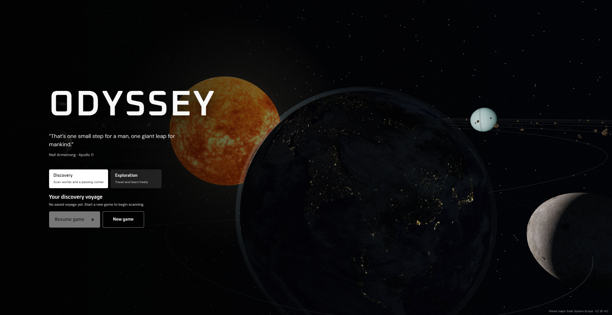

# Odyssey — Solar System Explorer

*For my brother, who inspired me to make this game.*

I built Odyssey so my brother could learn about the solar system by exploring it himself. He can pilot a ship to Saturn, see its rings up close, and open the Field Guide to learn what they're made of. I wanted the facts to be there when he had a question, right beside the world that made him curious.

**[Play Odyssey](https://odyssey-explorer-psi.vercel.app/)** on a desktop or laptop with a keyboard and mouse.



## What you can explore

- **Discovery** gives you a sky full of unidentified destinations. Aim at a world and hold **R** to identify it and add it to your Field Guide.
- **Exploration** gives you the full destination list from launch. Fly past the Moon, set a course for Jupiter with autopilot, or follow a guided Voyage.
- **Surface visits** let you land on all eight planets and the Moon. Follow survey flags to local landmarks, or take the hoverboard through the Fernlilt Grasslands on Earth.
- **Your ship** has a walkable cabin and cockpit with live views through the windows. Discoveries, encounters, and photos are saved in your browser.

## Where Odyssey is headed

I'm planning to grow Odyssey into a bigger exploration game, with more places to land and more ways to learn once you're there. On Earth, Fernlilt's twelve closed portals mark regions I'd like to make explorable, including Cirelune Marsh and the Dorynth Volcanic Fields.

## Flight controls

| Key | Action |
| --- | --- |
| **W / S** | Fly forward or reverse |
| **A / D** | Turn left or right |
| **Q / E** | Pitch up or down |
| **Shift + W** | Boost |
| **C** | Switch between first-person and third-person views |
| **F** | Open or close the Field Guide for the target in view |
| **P** | Engage or cancel autopilot for the selected destination |
| **I** | Enter the ship cabin |
| **L / T** | Open the Captain's Log / take a photo |

Open **?** in the game for the full control reference. On Earth, press **M** for the map, **B** for your backpack, and **H** to equip or stow the hoverboard.

## Run locally

Odyssey uses JavaScript, Three.js, and Vite. Use Node.js 20.19 or later in the 20.x series, or Node.js 22.12 or later.

```sh
npm ci
npm run dev
```

Open the local URL printed by Vite. The game runs in the browser and requires no API keys or database. Run the test suite and build with the following commands.

```sh
node --test tests/*.test.js
node scripts/check-audio.mjs
npm run build
```

Vite writes the static build to `dist/`. Use `npm run preview` to inspect it locally.

## Science and asset credits

The Field Guide links to NASA sources and credits its imagery. Odyssey compresses orbital distances, enlarges planets, and imagines explorable terrain on the giant planets. The [planetary visit notes](docs/PLANET_VISITS.md) describe the scientific references and fictional settings.

Solar System Scope / INOVE provides the planet textures under CC BY 4.0. The repository includes the [texture credits](public/planet-textures/ATTRIBUTION.md) and [surface audio credits](public/sounds/surface/ATTRIBUTION.md).
