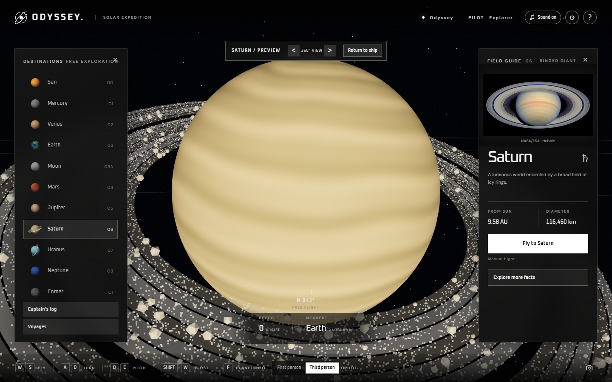

# Odyssey — Solar System Explorer

A desktop browser space exploration prototype built with Three.js, with first-person and third-person views. Odyssey combines free flight, guided discovery, and an interactive field guide to make exploring the solar system feel like a journey.



*Saturn in Exploration mode, with the destination list and Field Guide open.*

## Highlights

- Explore the Sun, planets, Earth's Moon, and a comet through free flight or autopilot.
- Choose **Discovery** to scan and reveal 11 destinations, or **Exploration** to browse them freely.
- Read NASA-sourced facts and credited imagery in each world's Field Guide.
- Record flybys, scans, and encounters in the Captain's log, with a photo gallery for flight snapshots.
- Follow optional Voyages and scan landmarks such as Olympus Mons, the Great Red Spot, and the Cassini Division.
- Name your pilot and choose original music, with responsive engine and collision audio.
- Use reduced motion settings for more immediate camera changes.

The intro includes **What’s new** and an **Update history** panel with dated gameplay additions. The history scrolls within its dialog and closes with its button or Escape.

## Built with

Three.js, JavaScript, Vite, and browser storage. The 3D scene includes animated planets, Saturn's particle rings, an asteroid belt, ship effects, and a comet. Progress and photos are saved in the browser for each game mode.

## Run locally

Use Node.js 20.19+ in the 20.x series, or 22.12+.

```sh
npm install
npm run dev
```

Open the local URL printed by Vite. For a production build and local preview, run `npm run build` followed by `npm run preview`.

## Deployment and analytics

Play at [odyssey-explorer-psi.vercel.app](https://odyssey-explorer-psi.vercel.app).
The Vercel project `odyssey-explorer` is connected to `Laurenceonly/Odyssey-Space-Exploration-Game`. Pushes to `main` build and publish production; other branches and pull requests receive preview deployments. Vercel uses `npm run build` and the `dist` output directory, as declared in `vercel.json`.

Vercel Web Analytics is initialized in production builds. Development runs do not load its tracking script. Enable Web Analytics for this project in the Vercel dashboard before deploying, then check for a successful `/_vercel/insights/script.js` request and a page-view request in the deployed site's network activity. A local production preview cannot serve Vercel's analytics endpoints. See [Vercel's setup instructions](https://vercel.com/docs/analytics/quickstart).

No game server or database is required. Player progress stays in each browser and does not transfer between domains. Local credentials, environment files, and deployment packages are excluded from uploads.

## Development records and checks

- [Dated commit history](CHANGELOG.md): commit descriptions, timestamps, links, and changed files.
- [Work log](docs/WORK_LOG.md): session notes, validation results, and pending work.

Player-facing update notes are maintained in `src/game-updates.js`, newest first. Its first entry supplies the intro highlight; the full list supplies Update history. Update these notes for every player-visible addition, improvement, bug fix, or removal. Prefix new notes with Added, Improved, Fixed, or Removed, and describe the resulting behavior in plain language. Keep dates accurate and the newest summary current.

All development record timestamps use Manila time (UTC+8). After committing changes, refresh the history with `node scripts/update-commit-history.mjs`; add a dated work-log entry for meaningful changes or checks.

```sh
node --test tests/*.test.js
node scripts/check-audio.mjs
npm run build
```

The [Playwright configuration](.playwright/cli.config.json) follows the native browser window size for interactive checks.

## Design notes

Odyssey favors readable navigation over astronomical scale: planets are enlarged and orbital distances compressed. Its Field Guide uses credited NASA imagery and source links. The three continuous music scores and flight sound effects were created for the project.

This is an interactive prototype, not a scientific simulator. Flight progress is local to the browser and does not sync between devices.
Startup shows only a loading screen until the planet surfaces, guide photos, fonts, texture uploads, and shaders are ready. Game UI stays hidden and cannot open during loading, including after refresh. The intro has no Settings button. The intro then starts with the finished planet details. Distant debris and comet effects update at a lower rate on the title screen; flight restores their full update rate.

Exploration launches near Earth above the Moon's orbital sweep. If a moving world overlaps the ship, including in a restored flight, the ship is moved clear so manual controls remain usable.

Open the local URL printed by Vite and choose a mode on the intro screen. The intro shows the ship flying slowly near Earth before the camera moves into third-person flight. Launch preserves the current view and ends at the same camera framing used during flight, including narrow desktop windows, avoiding a correction at the handoff. Refreshing during a flight resumes at the ship's last position and heading in the same browser tab. Use **W/S** to fly forward and back, **A/D** to turn left and right, **Q/E** to pitch the nose up and down, and **Shift+W** to boost forward. While holding **S**, A/D and the left/right arrow keys steer in reverse, like backing up a car. Reverse flight stays at normal speed and cancels the boost effect. Boost spools up and winds down, with brighter engine exhaust, subtle speed streaks, and a wider camera view. Q/E rotates the ship without moving it, is limited to 75° above or below level, and slowly returns to level after release. Press W to fly along the current heading. The **arrow keys** provide alternate turn and pitch controls. The ship banks into turns and carries visible navigation, engine, and nose lights. Switch between **First person** and **Third person** cameras with the buttons or **C**. Use the gear menu button to edit your name; it is saved in your browser and shown in a non-clickable pill with a circular profile icon in the header. Leenard is the default for new profiles; saved names remain editable. Opening the menu focuses the form rather than the name input and clears movement controls; release any held flight keys before typing. Panels, dialogs, cards, inputs, and rectangular controls use rounded corners and shared monochrome text/button colors.

The intro quotes Neil Armstrong's first step on the Moon, using [NASA's published wording](https://www.nasa.gov/history/50-years-ago-one-small-step-one-giant-leap/). Display text uses Oxanium; descriptions use DM Sans.

## Destinations and Field Guide

Click a destination, including Earth's Moon, to glide into a preview and open its info panel while the ship stays in place. Aim the ship's **+ reticle** at a planet to see its name; press **F** to open its info without entering preview, and press **F** again to close it. Choose **Fly to** or press **P** to return to the ship and engage autopilot. The ship turns toward the destination, boosts during the long cruise, steers around nearby bodies, and parks at a safe viewing distance. On arrival, the camera eases into the same planet scene used by a Destinations preview and opens the Field Guide while the ship holds position. Drag the scene to orbit around a preview, or use the **,** and **.** keys to turn the view in 45° steps. During autopilot, use **Cancel flight** or **P** to return to manual control. Movement inputs and browsing another destination keep the active course. Impacts trigger another approach instead of ending the trip; a stalled or overlong journey uses a brief fade into a safe arrival position. Autopilot leads moving destinations and follows entry/exit waypoints around obstacles. Recovery starts after 12 active seconds without progress, three contacts, or at most two minutes of active flight; timing uses actual frame duration even at low frame rates. Menus and hidden tabs pause the trip. Starting a new course clears old parking state. **Return to ship** appears in the Field Guide only during a planet preview and closes it without moving the ship. Reduced motion settings make camera switches immediate.

The Destinations panel has a close button and a labeled button to reopen it; its closed state is saved in this browser. The field guide opens when you choose a destination, arrive there by autopilot, or press **F** while aiming the + reticle at a planet or the Sun. Close it with **F** or its close button. Use **Field Guide** to reopen it; **F** also toggles it during a planet preview. A manual collision does not open the guide. **Explore more facts** shows rotation, orbit, atmosphere, notable features, and a link to NASA's full fact sheet for each world and the Sun. The Sun can be previewed from a safe distance but cannot be selected for autopilot. Planetary orbits and the asteroid belt are spaced 3.2 times farther apart to make flights take longer. The space backdrop is nearly black.

Field guide images in `public/planet-photos/` are NASA spacecraft photos or photo mosaics, credited and linked beside each image. Their source pages are recorded in `src/planet-photos.js`; `scripts/download-planet-photos.ps1` records the downloaded asset URLs. The Sun image is an ultraviolet observation, and the Earth image is a satellite mosaic.

## Supported devices and controls

Odyssey currently supports desktop and laptop browsers with a keyboard and mouse. Phones and tablets show a lightweight “Best explored on desktop” notice instead of loading the game, planet assets, or audio. Mobile gameplay is unavailable; the joystick and touch-only actions have been removed. Smaller desktop windows remain supported, and device detection does not use viewport width alone. Touchscreen laptops with a fine pointer can still play.

On Earth, use **WASD** to walk, hold the left mouse button and drag the scene to look, **J or Space** to jump, **Shift** to run, **C** to switch camera views, and **E** to board within 8 metres. Camera views are also available through the buttons.

## Landing on Earth

Choose **Exploration** for quick access, then open **Destinations → Earth** and choose **Fly to Earth**. Autopilot approaches and parks near Earth; **Land on Earth** then becomes available in the Field Guide. You can also approach Earth by flying manually. Landing requires an actual approach or parked arrival within 25 surface units; selecting Earth’s preview alone does not enable landing. In **Discovery**, scan Earth first. There is no separate ground-preview screen.

The ship descends to one grassy landing site beside a lake. Compact three-point landing gear deploys under the nose and wing roots, supports the hull above the ground, and retracts after lift-off. A welcome message addresses the saved pilot name. Choose **Explore outside** to walk among trees, rocks, and water. The articulated astronaut accelerates, turns, walks, runs, jumps, and lands with Earth gravity. Its two-joint legs use a simple alternating step cycle, bend knees forward without sideways twisting, and keep boots level. Medium strides and restrained lift avoid shuffling or exaggerated crouching. Stride follows actual distance and speed; terrain height, jumping, and landing drive foot placement and body weight. Your pilot name appears above the suit in third person and in the HUD in first person. The header profile pill is hidden on Earth to avoid a duplicate name. The same circular Settings icon used in space stays at the top right for sound and profile preferences. Earth orbital parking shows Parked near Earth / ready to land rather than a distance readout. Return near the ship to **Board spaceship**, then **Take off** to resume orbital flight. Water keeps the astronaut on shore; swimming is unavailable, and the walkable patch extends 104 metres from its centre.

The Captain’s log records landing, the first surface walk of each visit, boarding, and completed takeoff, with timestamps and snapshots. The surface **Log** button sits in a centered bottom row beside camera views and the photo button. Earth labels use white text directly over the scene, without background boxes. Buttons use translucent charcoal shading with white text/icons; Earth uses a stronger tint for daylight and space uses a lighter tint. Camera selection uses a brighter charcoal shade and border.

The site is a locally generated, stylized landscape; the globe retains its existing Earth maps. Photos work on the surface and are labeled Earth. Photos and logs remain local to the browser. Refreshing on the surface returns to orbital flight; surface position is not saved.

## Flight atmosphere

Open **Settings** from the gear menu during play to turn **Music and sound** on or off. The intro and header have no music icons. The checkbox reflects the saved preference, which persists across refresh; browser autoplay restrictions may require a click or key press before enabled audio starts. Muting affects music and flight effects. Music volume remains independent and is preserved when toggling sound.

Three original, continuous scores play in the browser: the original Odyssey theme, the cinematic Event Horizon, and the calmer Starlight Drift. Settings lets you choose a track or a playlist that rotates through all three; the choice and the 0%–150% music volume are saved in this browser. Track changes crossfade while you fly. Engine sound follows speed and boost, and the music softens during boost so flight cues remain clear. The Music and sound checkbox in Settings mutes music and effects. The game attempts to start music on load; browsers that restrict autoplay begin playback on the first click or key press.

The orbital ship and chase camera rig are scaled together to one fifth of their original size. Third-person flight retains the original projected ship framing and field of view while nearby worlds feel larger; first-person flight retains its original viewpoint. Collision clearance and onboard lighting follow the smaller orbital hull; the separate Earth surface scene keeps its astronaut-sized ship. The chase camera travels with the ship before easing turns, keeping its framing steady through uneven frame timing. Distant comet-tail and Saturn-ring effects update less frequently; nearby visits and previews retain detailed motion. Captain’s log thumbnails use asynchronous JPEG encoding. Orbital distances remain compressed for navigation rather than following one astronomical scale.
The rendered worlds use local 2K equirectangular maps from [Solar System Scope](https://www.solarsystemscope.com/textures/), licensed under [CC BY 4.0](https://creativecommons.org/licenses/by/4.0/). Credits also ship in `public/planet-textures/ATTRIBUTION.md` and appear in the Credits section of Settings. These NASA-data-based visualization maps include adjusted colors and reconstructed gaps. Earth has a separate cloud layer and night lights masked to its dark hemisphere. Thin atmospheric rims follow the Sun, Saturn casts a shadow onto its rings, and bare rock has restrained surface relief. Sunlight direction is consistent; brightness is balanced for the compressed game distances. Procedural surfaces remain available if a map cannot load.
The asteroid belt between Mars and Jupiter contains textured 3D rocks. Gentle contacts push rocks aside and deflect the ship without breaking them. Impact response uses relative closing speed, rock mass, and contact direction; strong impacts can fracture rocks, with ice breaking at a lower speed than stone. Swept contact checks prevent fast flight from skipping small rocks. Fragments inherit the rock's momentum and disperse with a faint dust cloud. Hull taps, heavier resonances, stereo direction, brief music ducking, and camera recoil scale with the actual impact; reduced motion disables camera shake. Autopilot routes around larger rocks.
Direct hits at normal forward speed (14 units/s) fracture small belt stones; larger rocks need stronger impacts. Glancing hits and rocks already moving with the ship can stay intact. Moving ring pieces use relative swept checks, and the first contact along the flight path is resolved before more distant rocks.
The engine responds to thrust load: coasting quiets the machinery, while boost adds a low filtered rumble that spools up and fades out smoothly. These are sounds heard aboard the ship. The scores use softly detuned pads, filtered stereo reverb, and dynamic compression to keep layered effects from clipping. Planetary lighting has darker night sides and Sun-facing atmospheric rims, and boost streaks stay restrained during flight.
After a world is unlocked, its Field Guide notes can point toward a nearby landmark. Aim the + reticle at Olympus Mons on Mars, Jupiter's Great Red Spot, or the Cassini Division in Saturn's rings and hold **R** from close range to record it. Landmark scans work in both modes, save separately, reveal a short NASA-sourced fact, and appear in the Captain's log. Discovery keeps a landmark's name hidden until it is scanned.
Saturn's rings include a visible gap and thousands of individual ice-colored particles. Larger drifting pieces can fracture on impact, while the gap leaves a sparse route through the rings. Saturn autopilot parks outside the ring edge for a manual approach. The ring and gap are inspired by [NASA's Saturn overview](https://science.nasa.gov/saturn/facts/).
While parked, the ship makes tiny attitude corrections with occasional side thruster flashes, and belt asteroids tumble slowly in place. These idle effects stop under reduced motion settings.

## Game modes

Choose **Discovery** or **Exploration** on the intro screen. Discovery always offers **Resume game** and **New game**. Resume restores the saved ship position and scans; New game clears Discovery progress and starts far beyond the planets, facing the solar system. The ship coasts forward on its own until you press a flight key, which smoothly hands you control. In Discovery mode, worlds and the comet stay unknown and locked in Destinations until you scan them; their names and Field Guide facts remain hidden, and autopilot cannot target them. Aim the ship's + reticle at a nearby object and hold **R** to scan it. Completed scans briefly frame the object, reveal its name and a fact, unlock it in Destinations, and count toward all 11 discoveries. Press a flight key or Escape to end the reveal early. Scan progress resets if you release R or lose the target; completed discoveries and the selected mode are saved in this browser. Scanning never opens the Field Guide automatically. Exploration mode lets you select, preview, read about, and autopilot to every destination without scanning.
In Discovery flight, a monochrome signal readout points toward the nearest unscanned object within range. It gives a relative direction and signal strength without revealing the object's identity. A soft two-tone receiver pulse gets more frequent as you approach and pans toward the source; scanning that object moves the signal to the next unknown destination.
One simulated comet follows a long elliptical orbit on the simulation clock. Its glowing coma, curved dust tail, and narrow blue ion tail strengthen near the Sun; a faint tail remains visible in the outer system to keep this stylized visitor recognizable. Tail particles stream away from the Sun, following [NASA's comet overview](https://science.nasa.gov/solar-system/comets/facts/). The close-up preview frames it from the side so the tails are visible. Discovery hides its identity until scanned; Exploration makes it available in Destinations and autopilot. A close encounter can be saved with a flight snapshot in the Captain's log.
Exploration also offers three optional Voyages: Inner Worlds, Giant Planets, and Outer Dark. Choose a route from the Voyages button below Captain's log, then visit each stop manually or use **Fly to next stop**. Route progress saves in this browser and never locks free flight.

## Captain's log and photos

The **Captain's log** button below Destinations, or the **L** key, opens a record of scans, close approaches and flybys, autopilot station keeping arrivals, and asteroid encounters. Its title uses the saved name from Settings, such as "Captain Leenard's Log." The button moves to the bottom of the Destinations panel while that panel is open. Each completed close pass creates its own entry with the closest surface distance, including later visits to the same world. Turning back near a world is recorded as a close approach. Collisions with different asteroids are logged separately. Recent entries include images captured from the flight view; older entries keep their text when image storage is needed for new events. The log retains the latest 250 entries separately for Discovery and Exploration in this browser; starting a new Discovery game clears that voyage's log. Entries for unscanned worlds keep their names hidden until those worlds are discovered.
Press **T** or the camera icon to save the current 3D view. Open Captain's log with **L**, then choose **Photo gallery**. Select a thumbnail to view it large; you can also download or delete your shots. The gallery holds up to 24 photos per mode in this browser. Photos aimed at unscanned objects keep their names hidden in Discovery. Starting a new Discovery game clears its gallery; Exploration photos stay saved.

The flight manual uses larger text and key labels, scrolls in smaller desktop windows, and closes with its × button or Escape. The browser tab icon adapts to the browser’s light/dark color scheme.
