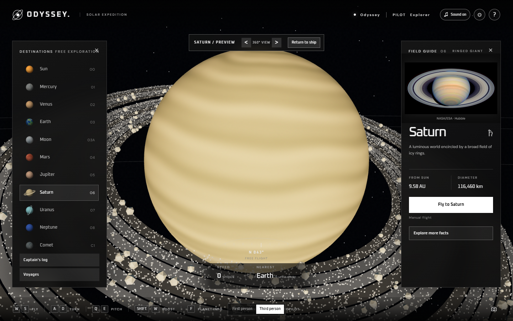

# Odyssey — Solar System Explorer

Odyssey is a 3D browser game about traveling through a stylized solar system. Pilot a ship past Saturn's rings, scan landmarks from orbit, or land on Earth and follow Fernlilt's trails by hoverboard.

[Play Odyssey](https://odyssey-explorer-psi.vercel.app/) on a desktop or laptop with a keyboard and mouse.



## Explore the solar system

- **Discovery** starts with unidentified destinations. Aim at a world and hold **R** to scan it and unlock its Field Guide entry.
- **Exploration** opens the destination list immediately. Fly manually, select a destination and engage autopilot, or follow an optional Voyage.
- **Planetary visits** let you land on all eight planets and the Moon after approaching in your ship. Find the survey marker to record a local observation. Earth also has swimming, a terrain map, and a hoverboard.
- **Walk inside** opens the cabin and cockpit, where the windows show the live view outside your ship. The Captain's Log records encounters and discoveries, and the photo gallery keeps your snapshots.

Fernlilt's twelve themed portals mark planned Earth destinations. Their gates are currently closed. Flight progress, discoveries, and photos are stored in your browser.

## Flight controls

| Key | Action |
| --- | --- |
| **W / S** | Fly forward or reverse |
| **A / D** | Turn left or right |
| **Q / E** | Pitch up or down |
| **Shift + W** | Boost |
| **C** | Switch between first-person and third-person views |
| **F** | Open or close the Field Guide for the target in view |
| **P** | Engage or cancel autopilot for the selected destination |
| **I** | Enter the ship cabin |
| **L / T** | Open the Captain's Log / take a photo |

Open **?** in the game for the full control reference. On Earth, press **M** for the map, **B** for your backpack, and **H** to equip or stow the hoverboard.

## Run locally

Odyssey uses JavaScript, Three.js, and Vite. Use Node.js 20.19 or later in the 20.x series, or Node.js 22.12 or later.

```sh
npm ci
npm run dev
```

Open the local URL printed by Vite. The game runs in the browser and requires no API keys or database. Run the test suite and build with the following commands.

```sh
node --test tests/*.test.js
node scripts/check-audio.mjs
npm run build
```

Vite writes the static build to `dist/`. Use `npm run preview` to inspect it locally.

## Science and asset credits

The Field Guide links to NASA sources and credits its imagery. Odyssey compresses orbital distances, enlarges planets, and imagines explorable terrain on the giant planets. The [planetary visit notes](docs/PLANET_VISITS.md) describe the scientific references and fictional settings.

Solar System Scope / INOVE provides the planet textures under CC BY 4.0. The repository includes the [texture credits](public/planet-textures/ATTRIBUTION.md) and [surface audio credits](public/sounds/surface/ATTRIBUTION.md).
