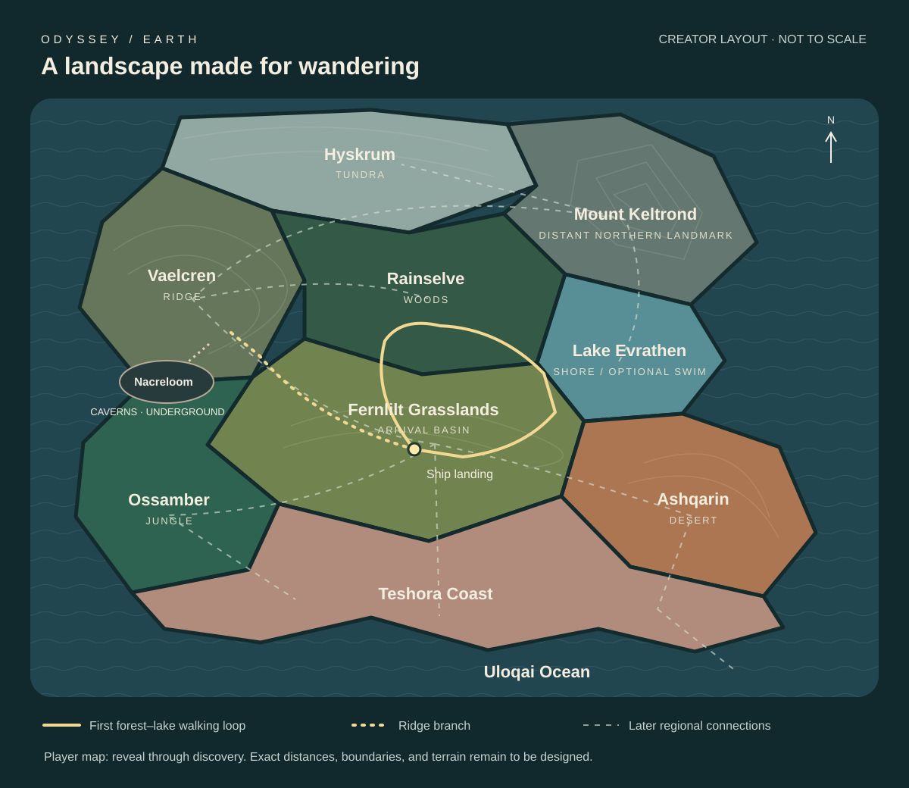

# Odyssey — Earth region layout

Created: 2026-10-16 (Asia/Manila).

Status: proposed spatial layout. The original schematic below predates Cirelune and Dorynth; it is a design artifact, not the current player map or surveyed geography. North is up; distances and region extents are not to scale. The current in-game map shows all thirteen destinations and closed portals. See [exploration plan](EARTH_EXPLORATION_PLAN.md).

*Historical October 16 diagram: it does not include the two destinations added on October 29. Use the in-game map for the current portal positions.*

## Arrival and first journey

Land in Fernlilt Grasslands with open ground around the ship. Orient the first view toward an inviting woodland edge, with Vaelcren visible to the left and Keltrond on the distant northern skyline. A lone tree on a low rise gives a nearby destination. The lake should appear in glimpses rather than being fully exposed at touchdown.

The first connected route travels north from Fernlilt into Rainselve, then turns east along the woodland edge to Lake Evrathen. A lakeshore route returns southwest through grassland to the ship, forming a loop. No mandatory swim or climb is needed to complete this first route.

A second route branches west from Fernlilt toward Vaelcren. Its gradual ascent provides a view back across the ship, woods, and lake. Keltrond is a distant visual destination during this initial slice, not a falsely advertised reachable summit inside the existing small boundary.

## Full region arrangement

| Region | Position | Land connections and transition |
|---|---|---|
| Fernlilt Grasslands | Central arrival basin | Rainselve to north; Evrathen to northeast; Vaelcren to west; Ossamber to southwest; Teshora to south; gradual dry grass toward Ashqarin to southeast |
| Rainselve Woods | North of landing | Fernlilt, western Evrathen shore, and lower Vaelcren slopes; denser trees and softer light arrive gradually |
| Lake Evrathen | Northeast of landing, below mountain foothills | Rainselve and Fernlilt shore paths; a future foothill route toward Keltrond; preserve dry shore access and an optional swim |
| Vaelcren Ridge | West/northwest | Fernlilt, Rainselve, Nacreloom entrance, and a longer upland approach to Keltrond |
| Nacreloom Caverns | Inside western ridge foothills | Accessible mouth from Vaelcren, with a separate lower approach from Fernlilt; underground passages must not become an accidental required shortcut |
| Mount Keltrond | Far north/northeast skyline | Upland approach from Vaelcren and foothill approach from Evrathen; higher route reaches Hyskrum |
| Hyskrum Tundra | Northern high plateau | Keltrond highlands; transition through sparse alpine vegetation, frost, then persistent snow |
| Ossamber Jungle | Southwest sheltered basin | Fernlilt and western Teshora; taller vegetation and wetter ground accumulate gradually |
| Ashqarin Desert | Southeast dry basin | Fernlilt through dry grassland and scrub; eastern Teshora through sandstone bluffs and sandy shore |
| Teshora Coast | Southern shoreline | Fernlilt, Ossamber, and Ashqarin approaches; beaches and headlands open toward Uloqai |
| Uloqai Ocean | South/east beyond shoreline | Teshora shallows, reefs, then deeper water; do not imply the full ocean is safely traversable with current swimming stamina |
| Cirelune Marsh | East/northeast of Fernlilt, between the lake and desert entrances | Planned peat bog; its closed entrance is marked on Fernlilt's map |
| Dorynth Volcanic Fields | East/southeast of Fernlilt, between Cirelune and the desert entrance | Planned cooled-lava landscape; its closed entrance is marked on Fernlilt's map |

Caves occupy an underground layer, not a flat surface biome patch. Rivers and minor paths can remain unnamed connective features. The map is an invented Earth-inspired region, not a claim that these biomes border one another in a real geographic location.

## Readability and scale

- Use landmarks to orient: Keltrond north, Vaelcren west, open ocean south/east.
- Keep ship access open and reserve flat ground around touchdown and boarding.
- Make the first journey a loop, with optional branches rather than a corridor or maze.
- Use terrain and vegetation to compose reveals, without invisible restrictions around ordinary scenery.
- Blend audio, ground cover, and lighting across shared edges; avoid abrupt rectangular biome borders.
- Do not pack all regions into Fernlilt. Its playable radius is 560 metres; dimensions and travel times for the other twelve regions remain uncommitted.
- The in-game map and minimap use themed destination icons; the full map colors the entrance-route branches to match.
- Cirelune and Dorynth were added after the original eleven-region schematic; their portals are closed and their destination terrain has not been built.

## Map disclosure

This creator-facing schematic shows the intended whole layout. The player map should initially show the discovered landing surroundings and keep unknown areas under fog. Reveal regions and smaller landmarks through travel. Avoid displaying undiscovered region names or misleading lock icons by default. Map implementation, persistence, and reveal granularity remain separate work.

## First playable slice acceptance targets

1. Landing, disembarking, and boarding remain reliable at Fernlilt.
2. A clear walkable loop connects grassland, woodland, and lake without forced swimming or jumping.
3. Vaelcren offers a walkable overlook; Keltrond reads as a distinct distant landmark.
4. Rendered shore geometry agrees with physics; no exposed floating water edge.
5. Trees and rocks do not obstruct the main route or trap the astronaut.
6. Discovery states and map art reflect only areas actually reachable in the implementation.
7. Check terrain slopes, save compatibility, rendering cost, and movement regressions; visually review the arrival and lake reveal before calling the scenery complete.

## Local prototype status — October 16

Fernlilt is implemented with a 560 m playable radius (1.12 km diameter, approximately 0.985 km²). Its pond remains at (34, -30), with small edge groves and gentle rises inside the grasslands. Far mountain scenery is outside the playable region and does not constitute a built or discovered Mount Keltrond. The schematic above remains a planning diagram. The actual map, golden-hour landscape, and FPS counter have been checked in a browser.

## Creator correction — large independent regions

Each selected name denotes a substantial destination/region in its own right. Lake Evrathen is a large lakeside region, not a small pond named inside Fernlilt. Rainselve, Vaelcren, and all other named regions likewise need their own substantial areas. The compact terrain prototype must not count its pond, woodland patch, or rise as discoveries of those full regions. Small unnamed ponds, groves, and hills can exist within a region without inheriting another region's name.

The earlier compact multi-region labels are superseded. The current landing patch is only an early Fernlilt prototype. The creator is choosing whether the large regions join as one continuous landscape or use travel transitions; no scale or travel architecture is finalized yet. Map disclosure must distinguish a region that exists but is undiscovered from a region whose terrain is not yet built.
